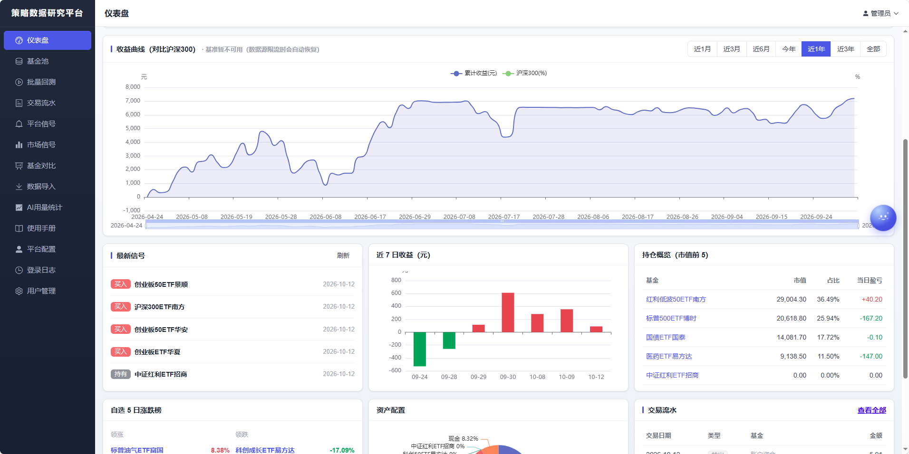
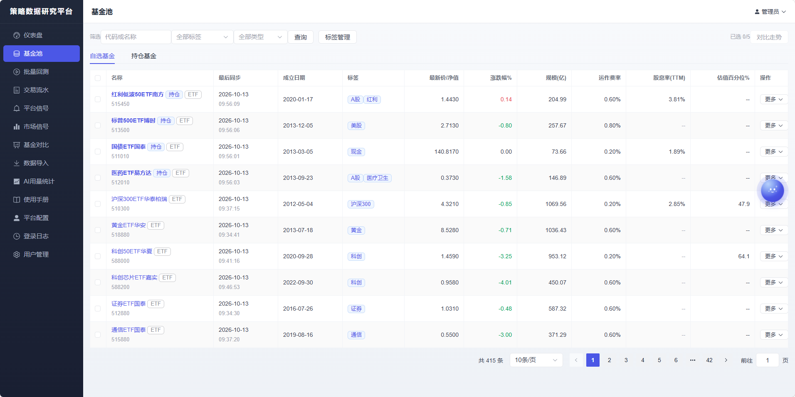
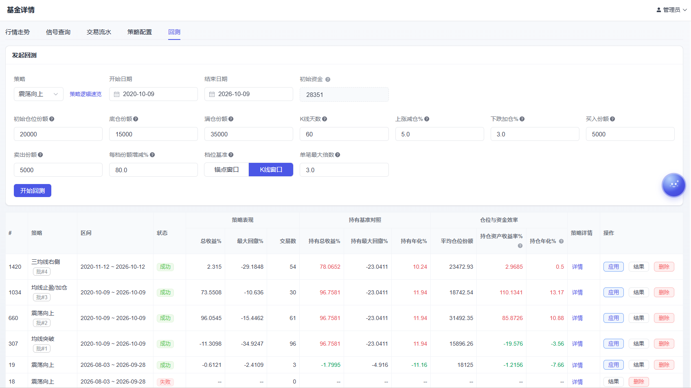
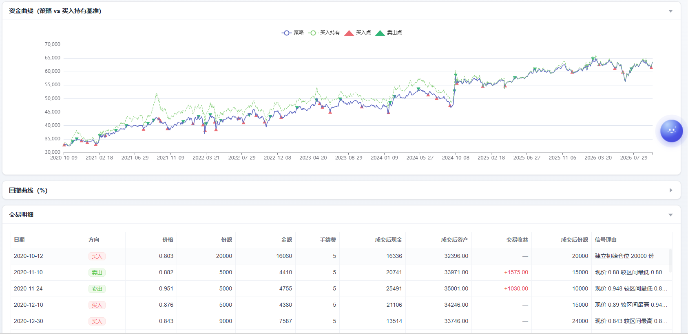
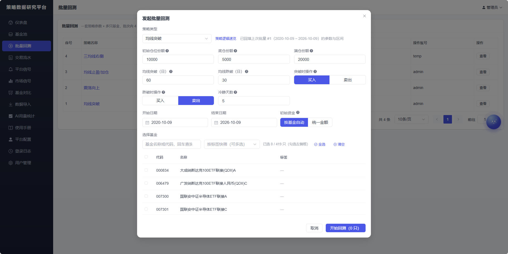
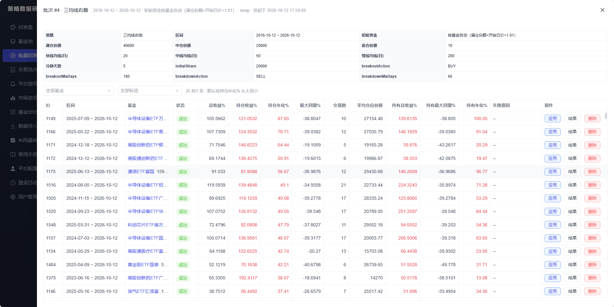
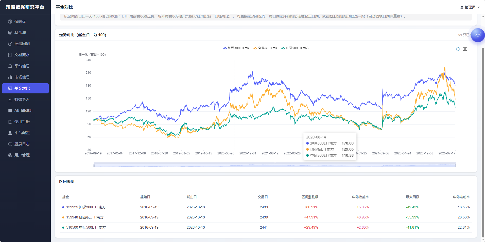

# 策略数据研究平台

> **该平台仅供个人学习和参考，不构成投资建议，投资决策与风险由本人承担。**

只给买卖建议、不做自动化交易、只覆盖指数基金（场内 ETF + 场外指数基金）的策略数据研究平台。
单应用多模块（Spring Boot 4 / JDK 21）+ Vue3 前端打包嵌入 jar，单容器部署。

## 演示账户

**体验地址**：[quant.yuxi25.cn](https://quant.yuxi25.cn)

| 账号 | 密码 | 权限 |
| --- | --- | --- |
| `temp` | `123456` | 只读查看：仪表盘 / 基金池 / 平台信号 / 市场信号 / 基金对比 / 交易流水 / 批量回测 / 使用手册 |


## 系统截图

| 仪表盘 | 基金池 |
| --- | --- |
|  |  |

| 基金回测 | 回测结果 |
| --- | --- |
|  |  |

| 批量回测 | 批量回测结果 |
| --- | --- |
|  |  |

| 基金对比 |
| --- |
|  |

## 功能一览

| 功能 | 说明 |
| --- | --- |
| 仪表盘 | 17 个全球指数看板（A 股/港 股/美 股/亚 太/欧 洲分组）、资产 KPI 卡、收益曲线（含沪深300 基准）、收益日历、信号/涨跌榜/资产配置速览 |
| 记账与流水 | 买入/卖出/分红/资金转入转出五类记账，价格按金额÷数量自动派生，即时预估持有份额与浮动/已实现盈亏 |
| 行情图表 | K 线/净值 + MA/BOLL/MACD 指标、股息率副图、任意区间加载与图上框选、买卖分红交易标记、双击全屏 |
| 基金对比 | 最多 5 只归一化走势对比 + 区间涨跌幅/最大回撤/年化波动率 |
| 数据导入 | 场内 ETF 与场外指数基金导入（代码校验、近 15 年历史、异步进度）；每周三自动导入符合条件的新基金 |
| 策略回测 | 9 种策略（网格族/震荡向上/均线突破/均线止盈加仓/双均线右侧/三均线右侧，插件式扩展：新增策略 = 新增一个实现类），单次与批量回测，收益/年化/回撤/夏普/胜率完整指标 |
| 平台信号 | 策略信号 + 均线上/下穿信号，按基金/方向/策略/日期筛选，支持邮件摘要与企业微信推送 |
| 市场信号 | 自看指标看板：多周期涨跌榜、估值红绿灯（PE 百分位）、技术面与 ETF 溢价 |
| AI 助手 | 全站浮窗流式对话；厂商/模型/Token 按厂商各存（智谱/千问/DeepSeek/Kimi/MiniMax）；7 类工具实时取数；用量与费用统计、每日额度 |
| 安全与管理 | 登录日志（IP 归属地）、防爆破锁定、临时账号逐项授权、每日数据备份 |

## 技术栈（主线）

- **后端**：JDK 21 · Spring Boot 4.1（Maven 多模块）· MyBatis-Plus · Sa-Token · Spring AI · Redisson
- **前端**：Vue 3.5 + TypeScript + Vite + Element Plus + ECharts（构建产物打包进 jar，单 jar 部署）
- **存储**：MySQL 8.4（`schema.sql` 启动期幂等建表）+ Redis 7（会话/缓存/任务进度）
- **数据源**：东方财富公开接口（ETF 日 K、场外净值、基金档案与分红、全球指数）+ 中证指数官网（指数 PE 历史）
- **质量门禁**：后端 `mvn verify`（PMD p3c 阻断）· 前端 `npm run type-check`（0 错误）+ `npm run check:style`（样式 token 门禁）

```
quant-common    公共模块（响应体/异常/traceId/工具类/分布式锁）
quant-system    登录鉴权与用户管理（BCrypt、防爆破锁定）
quant-fund      基金池/数据导入/增量同步/持仓流水/收益统计/仪表盘聚合
quant-strategy  策略引擎/回测引擎/信号计算/邮件与微信通知
quant-ai        AI 投资助手（流式对话 + 工具调用 + 会话记忆 + 用量额度）
quant-web       启动与打包（含前端静态资源托管）
web/            Vue3 前端源码
docs/           需求(01) / 技术设计(02) / 任务清单(03) / 验收报告(04) / 使用手册(05) / 截图(screenshots)
deploy/         部署辅助（Docker Compose、1Panel 编排、MySQL 每日备份）
```

## 快速开始

**本地开发**：要求 JDK 21、Maven 3.8+、Node 20+、本地 MySQL（库 `quant`，utf8mb4）与 Redis。

```bash
mvn spring-boot:run -pl quant-web        # 后端（dev profile，首次启动自动建库建表）
cd web && npm install && npm run dev     # 前端（Vite 开发服务器，/api 代理到 8080）
```

**Docker 一键部署**（应用 + MySQL + Redis + 每日备份）：

```bash
cp .env.example .env    # 填写 DB_PASSWORD / DB_ROOT_PASSWORD 等
docker compose up -d --build
# 访问 http://localhost:8080
```

服务器装有 1Panel 时，可用 `deploy/1panel/docker-compose.yml` 复用面板已有的 MySQL/Redis（编排文件内有配置说明）。

> 使用层面的问题（功能怎么用、参数含义、报错怎么办）见侧栏【使用手册】或 `docs/05-使用手册.md`，也可以直接问站内 AI 助手（它读的是同一份手册）。

## 给 AI 编码助手

仓库根的 `AGENTS.md` 与 `.zcode/skills/` 是本项目的 AI 协作约定与技能（`CLAUDE.md`、`.claude/skills/` 是由 `sh sync-memory.sh` 生成的完整镜像，勿手改）；人类读者可忽略。

## 开源协议

本项目基于 [MIT License](LICENSE) 开源，可自由使用、修改与分发；保留版权与许可声明即可。
